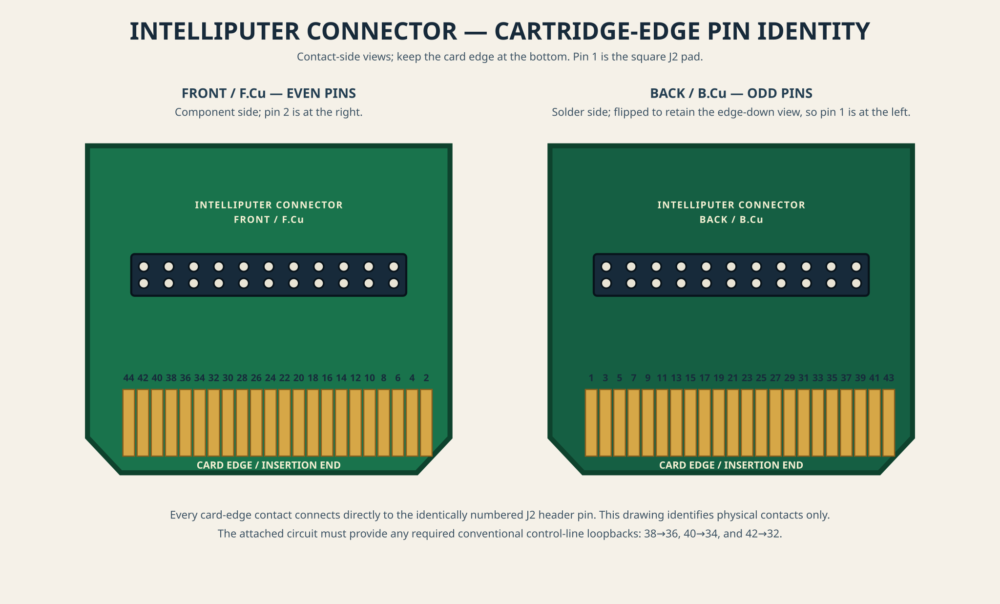

# Intelliputer Connector

Passive 44-contact Intellivision cartridge card-edge to 44-way ribbon-header adapter.

Open [the Intelliputer Connector design](project/intelliputer_connector.kicad_pcb) in KiCad. Its
card-edge contacts connect one-to-one with the 2×22 through-hole ribbon header;
the board uses the original cartridge outline.

## Cartridge-port pin assignment

The board is a direct pass-through: `J1 pin n` connects only to `J2 pin n`.
The assignment below correlates those numbers with the published
[Intellivision cartridge-port specification](https://wiki.intellivision.us/index.php/Cartridge_Port).
For a complete, repository-local technical reference derived from that source,
see [the cartridge-port reference](documentation/intellivision-cartridge-port-reference.md).
For safe bench wiring, start with the
[pinout safety guide](documentation/pinout-safety-guide.md).
The source PCB also prints the compact 1–44 net-name table on its B.Cu
silkscreen.
With the card edge at the bottom and the header viewed from the component side,
the J2 upper row runs from `2` at the right through `44` at the left, while the
lower row runs from `1` at the right through `43` at the left; pin 1 is the
square pad. On an inserted cartridge, that component/silkscreen side is the
**top**: it carries the even card-edge contacts. The B.Cu solder side is the
**bottom** and carries the odd contacts.

The diagram is vector artwork (2400 × 1450 SVG), so it may be enlarged or
printed without loss of detail. A 2400 × 1450 PNG version is also available:
[download the pinout image](documentation/images/intellivision-cartridge-pinout.png).
The bottom-side view is flipped to retain an edge-down orientation; this places
pin 1 at the left in that panel.

| J1 / J2 pins | Published Intellivision signal(s) |
| --- | --- |
| 1 / 2 | GND / GND (pin 2 is external video on Intellivision II) |
| 3 / 4 | `~MSYNC` / `CBLNK` |
| 5 / 6 | `DB7` / external audio in |
| 7 / 8 | `DB8` / external video in |
| 9 / 10 | `DB6` / `MCLK` |
| 11 / 12 | `DB9` / `RESET` |
| 13 / 14 | `DB5` / `SR1` |
| 15 / 16 | `DB10` / Intellivoice serial out |
| 17 / 18 | `DB4` / Intellivoice serial in |
| 19 / 20 | `DB11` / Intellivoice ROM disable |
| 21 / 22 | `DB3` / GND |
| 23 / 24 | `DB12` / GND |
| 25 / 26 | `DB13` / GND |
| 27 / 28 | `DB2` / GND |
| 29 / 30 | `DB14` / `~BUSAK` |
| 31 / 32 | `DB1` / `BC1` in |
| 33 / 34 | `DB0` / `BC2` in |
| 35 / 36 | `DB15` / `BDIR` in |
| 37 / 38 | `BDIR` out / duplicate `BDIR` out |
| 39 / 40 | `BC2` out / duplicate `BC2` out |
| 41 / 42 | `BC1` out / duplicate `BC1` out |
| 43 / 44 | +5 V / GND |

### Bus-control loopbacks

The CP1610 supplies three raw bus-control outputs on two duplicate contacts:
`BDIR` on 37/38, `BC2` on 39/40, and `BC1` on 41/42. A conventional ROM
cartridge bridges one copy of each output to the corresponding reflected
control input:

| Bridge on the attached circuit | Function |
| --- | --- |
| `38 -> 36` | Sends `BDIR` to the reflected `BDIR` input. |
| `40 -> 34` | Sends `BC2` to the reflected `BC2` input. |
| `42 -> 32` | Sends `BC1` to the reflected `BC1` input. |

These bridges let the console's cartridge-port control outputs reach the
signals used by the EXEC ROMs, PSG, and 8-bit RAM. They also give an external
device such as the Keyboard Component a place to intercept or alter a bus
cycle before returning the control signals. The duplicate contacts avoid vias
on a conventional double-sided cartridge PCB.

This passive adapter **does not** add these bridges. Add them in the circuit
attached to J2 for ordinary cartridge-ROM behavior. Do not add them when the
attached device must intercept or generate the reflected controls; use the raw
outputs on 37/39/41 and drive the inputs on 36/34/32 deliberately instead.

## Current status

- The 1:1 routing is complete, including the repaired `CARD_14` connection.
- The card/tongue end is shortened by 15 mm (83.91 mm overall board length)
  and includes centered front-silkscreen artwork.
- KiCad 10.0.7 DRC passes with **zero violations** and **zero unconnected
  items**.
- The current fabrication package is available as
  [Intelliputer-Connector-Gerbers-r1.1.zip](manufacturing/Intelliputer-Connector-Gerbers-r1.1.zip).
  It contains the `.gbr` Gerbers, Excellon drill data, drill map, and current
  DRC and drill reports.

See the [fabrication package notes](manufacturing/README.md) for board-house
requirements and file details.
